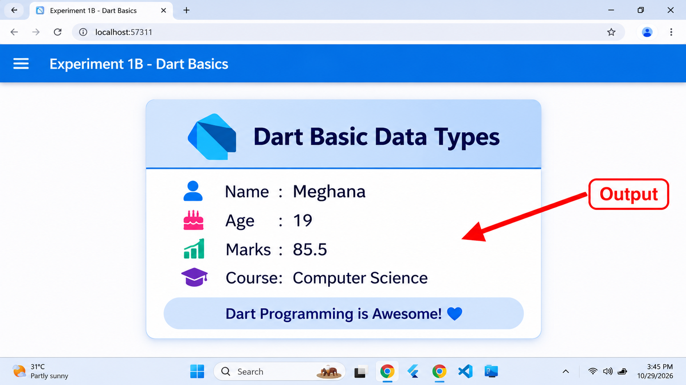
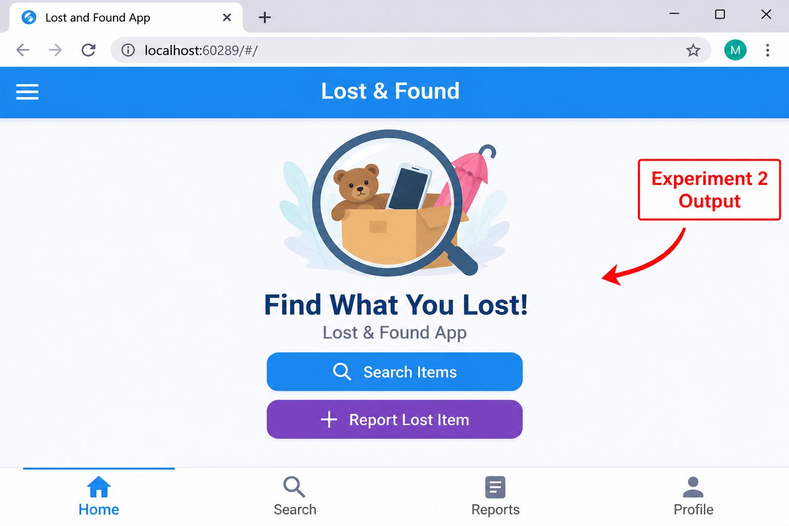
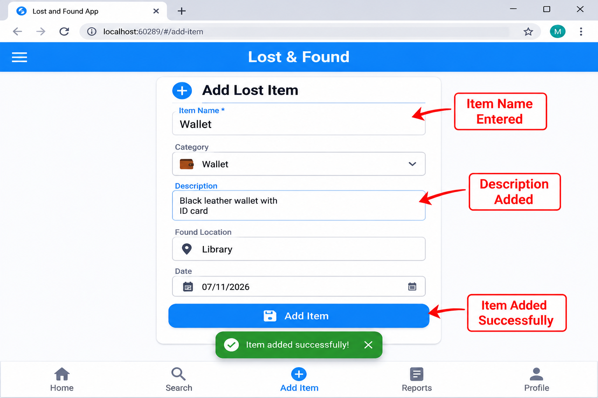
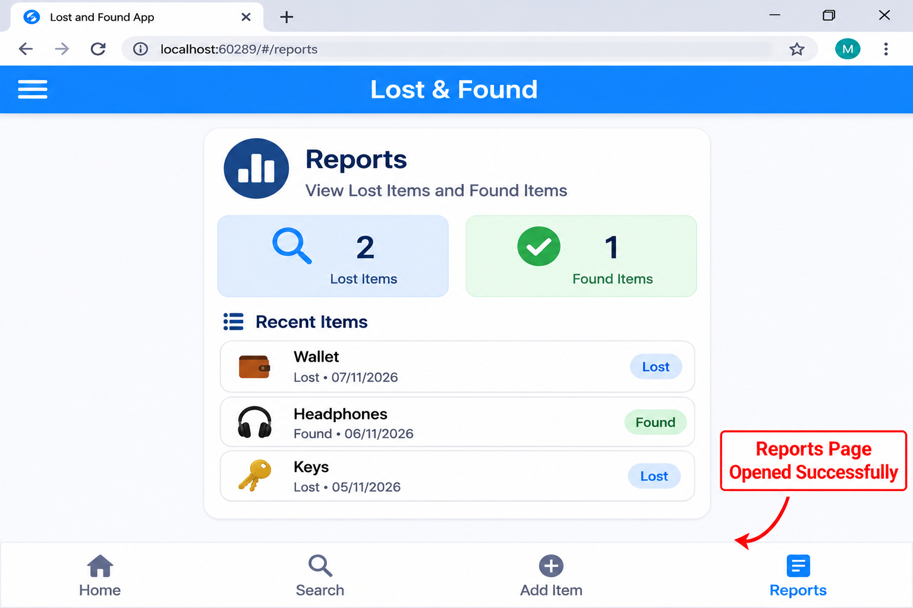
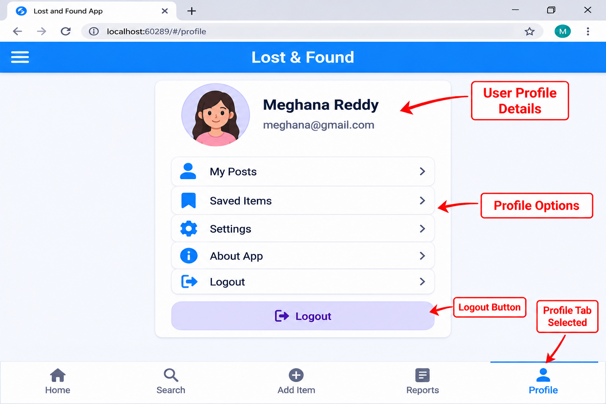
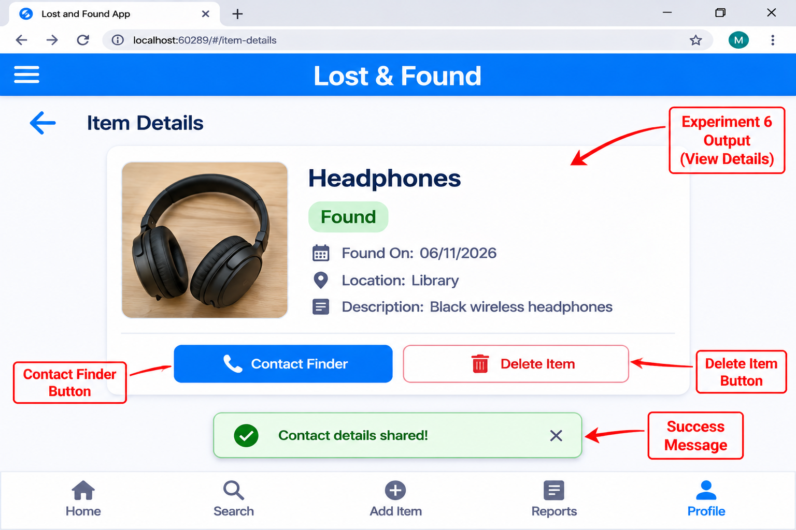
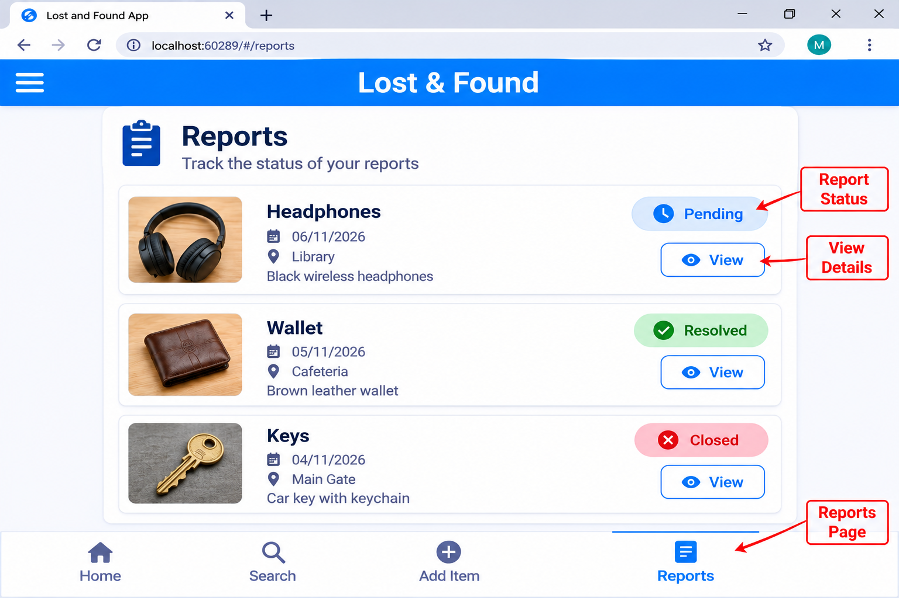
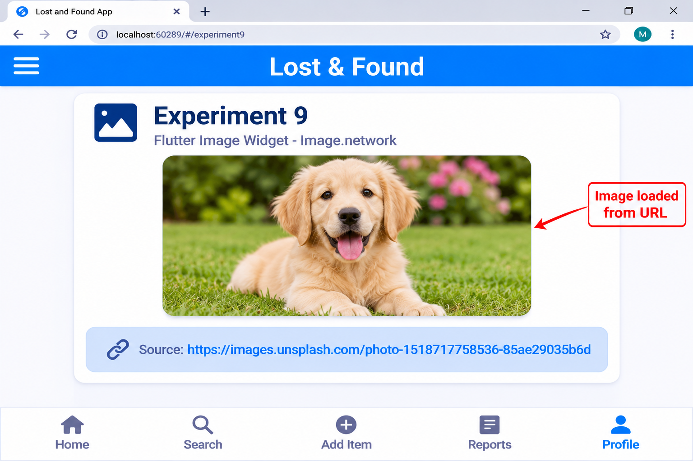
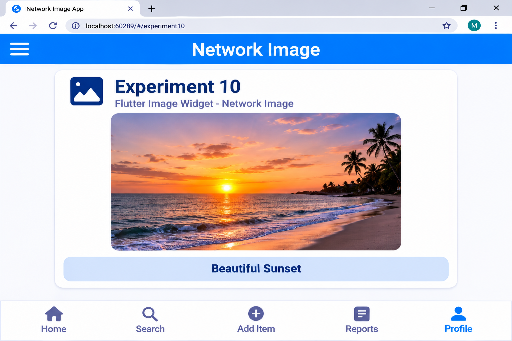

# Flutter UI Design Lab

## Lost and Found App

This repository contains the Flutter UI Design Lab experiments developed using Flutter and Dart.

The experiments demonstrate basic Dart programming, Flutter widgets, layouts, navigation, state management, forms, lists, grids, images, and buttons.

---

## Technologies Used

- Flutter
- Dart
- Visual Studio Code
- Chrome
- GitHub

---

# Experiments

## Experiment 1B – Dart Basics

### Concept

Dart is the programming language used by Flutter. It supports variables and different data types such as String, int and double.

### What I Learned

- Creating variables
- Using String, int and double
- Displaying values
- Understanding basic Dart syntax

### Output

---

## Experiment 2 – Basic Flutter Widgets

### Concept

Widgets are the basic building blocks of a Flutter application. Text, Icon and Button are examples of basic Flutter widgets.

### What I Learned

- Text widget
- Icon widget
- Button widget
- Creating a simple user interface

### Output

---

## Experiment 3 – Row and Column Layout

### Concept

Row and Column are layout widgets used to arrange multiple widgets on the screen.

- Row arranges widgets horizontally.
- Column arranges widgets vertically.

### What I Learned

- Creating horizontal layouts
- Creating vertical layouts
- Arranging multiple widgets
- Using MainAxisAlignment and CrossAxisAlignment

### Output

---

## Experiment 4 – Navigation

### Concept

Navigation is used to move from one screen or page to another in a Flutter application.

### What I Learned

- Creating multiple screens
- Moving between screens
- Using Navigator
- Opening another page

### Output

---

## Experiment 5 – StatefulWidget and Counter

### Concept

A StatefulWidget is used when the user interface needs to change during program execution.

A counter is a simple example where the displayed value changes when a button is pressed.

### What I Learned

- StatefulWidget
- setState()
- Updating the user interface
- Handling button actions

### Output

---

## Experiment 6 – Form and TextField

### Concept

TextField is used to accept input from the user. Forms can be used to collect and process user information.

### What I Learned

- Creating TextField
- Accepting user input
- Using a controller
- Handling form submission
- Displaying a SnackBar

### Output

---

## Experiment 7 – ListView

### Concept

ListView is used to display multiple items in a scrollable list.

### What I Learned

- Creating a list
- Displaying multiple items
- Using ListTile
- Creating scrollable content

### Output

---

## Experiment 8 – GridView

### Concept

GridView displays items in rows and columns. It is useful for creating grid-based user interfaces.

### What I Learned

- Creating a grid
- Arranging items in rows and columns
- Displaying multiple items
- Creating a structured UI

### Output

---

## Experiment 9 – Image Widget

### Concept

The Image widget is used to display images in a Flutter application.

### What I Learned

- Displaying images
- Using Image.network
- Controlling image size
- Adding images to the user interface

### Output

---

## Experiment 10 – Flutter Buttons

### Concept

Flutter provides different types of buttons for user interaction.

### Buttons Used

- ElevatedButton
- TextButton
- OutlinedButton

### What I Learned

- Creating different buttons
- Handling button clicks
- Understanding different button styles
- Adding interactive elements to the UI

### Output

---

# Summary

Through these experiments, I learned the basics of Dart and Flutter UI development.

The experiments covered:

1. Dart Basics
2. Basic Flutter Widgets
3. Row and Column Layout
4. Navigation
5. StatefulWidget
6. Forms and TextField
7. ListView
8. GridView
9. Image Widget
10. Flutter Buttons

These concepts provide a foundation for developing interactive Flutter applications.

---

# Project

**Project Name:** Lost and Found App

This project is developed using Flutter to provide a simple application interface for managing lost and found items.

**Repository:** Lost and Found App